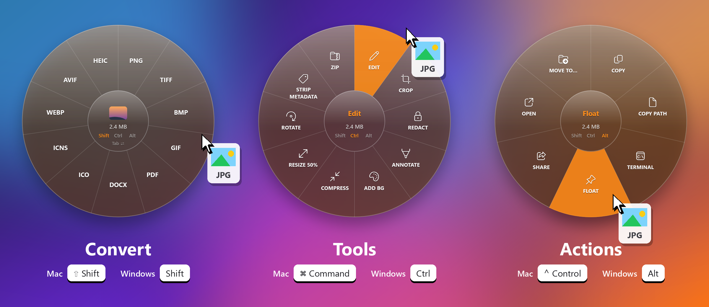
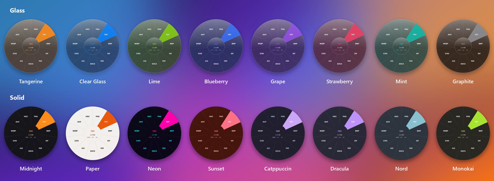

<p align="center">
  
</p>

<h1 align="center">Satsuma</h1>

<p align="center">
  <b>Drag a file. Tap a key. Drop it on a format.</b><br>
  An open-source, offline file converter that lives in your menu bar or system tray.
</p>

<p align="center">
  <a href="https://github.com/ArekatlaNishanthchowdary/satsuma/releases/latest"></a>
  
  
  <a href="LICENSE"></a>
  
</p>

<p align="center">
  <a href="https://github.com/ArekatlaNishanthchowdary/satsuma/releases/latest"><b>⬇ Download for Mac (Intel)</b></a>
  &nbsp;·&nbsp;
  <a href="https://github.com/ArekatlaNishanthchowdary/satsuma/releases/latest"><b>⬇ Download for Windows</b></a>
</p>

<p align="center">
  
</p>

---

## Why Satsuma

- **No windows, no upload page, no "choose output format" dialog.** The wheel appears right under your pointer, mid-drag.
- **Feels physical.** Every tool and action has its own icon, and a soft mechanical *click* (plus a trackpad tap on Mac)
  marks each option as you sweep across the wheel. Turn it off with **Click Sound on Hover**.
- **Private by design.** Every conversion runs on your computer. Nothing is uploaded, and there's no account, no telemetry and no network calls.
- **Free and open source.** MIT licensed, with no trial limit and no subscription.
- **Runs where Tangerine doesn't.** Built for **Intel Macs** (and Apple Silicon from source) and for **Windows**.

## How it works

1. **Start dragging** any file, or several, in Finder or File Explorer, and keep holding the mouse button.
2. **Tap a key.** A wheel of options opens around the pointer:

   | Wheel | Mac | Windows | What's on it |
   |---|---|---|---|
   | **Convert** | <kbd>⇧ Shift</kbd> | <kbd>Shift</kbd> | Every output format for that kind of file |
   | **Tools** | <kbd>⌘ Command</kbd> | <kbd>Ctrl</kbd> | Editors (crop, trim, redact…), compress to size, organize PDF pages, merge, extract… |
   | **Actions** | <kbd>⌃ Control</kbd> | <kbd>Alt</kbd> | Copy, Copy Path, Terminal, Move To…, Float, plus AirDrop & Quick Look (Mac) or Share & Open (Windows) |

3. **Drop on a slice.** The result is saved **next to the original** and highlighted in Finder or Explorer.
   Drop in the middle to cancel; tap another key to switch wheels.

Prefer clicking? Use **Choose Files…** in the menu bar or tray icon. On Windows you can also turn on
**right-click → Send to → Satsuma**.

## What it converts

| Kind | Convert to | Tools |
|---|---|---|
| 🖼 **Images**: JPG, PNG, HEIC, TIFF, BMP, GIF, WebP, AVIF, SVG¹ | JPG · PNG · HEIC · TIFF · BMP · GIF · PDF · DOCX · WebP² · AVIF² | **Edit** · **Crop** · **Redact** · **Annotate** · **Add BG** · Compress to size · Resize 50% · Rotate · Strip Metadata · Read QR¹ · Make PDF · Collage |
| 🎵 **Audio**: MP3, M4A, WAV, FLAC, OGG, Opus, AIFF, WMA, AAC | MP3 · M4A · WAV · FLAC · OGG · Opus · AIFF · WMA | **Trim** · **Bleep** · **Channels** · **Visualize** · **Split** · Compress to size · Normalize · Trim Silence · Strip Metadata · Join |
| 🎬 **Video**: MP4, MOV, MKV, WebM, AVI, WMV, M4V | MP4 · MOV · MKV · WebM · AVI · WMV · GIF · MP3 · M4A | **Trim** · **Split** · **Speed** · **Crop** · **Redact** · Compress to size · Snapshot · Mute · Extract Audio · Strip Metadata · Join |
| 📄 **PDF** | PNG / JPG (every page, 300 DPI) · TXT · Markdown · DOCX · RTF · HTML · XLSX · EPUB³ · PPTX⁴ | **Organize** · Compress · Split Pages · Rotate · Merge · Strip Metadata |
| 📝 **Documents**: DOCX, ODT, RTF, HTML, TXT, Markdown, EPUB³ (+ DOC, RTFD, webarchive on Mac) | PDF · DOCX · ODT · RTF · HTML · TXT · Markdown · EPUB³ | |
| 📊 **Spreadsheets**: CSV, TSV, XLSX, ODS, XLS⁴ | CSV · TSV · XLSX · ODS · PDF | |
| 📽 **Slides**⁴: PPT, PPTX, ODP | PDF · PNG · JPG | |
| 💬 **Subtitles**: SRT, VTT | SRT · VTT · TXT | |
| 🗜 **Archives**: ZIP, TAR, TAR.GZ, GZ, RAR, 7z | ZIP · TAR · TAR.GZ | Extract |
| 📁 **Anything** | | Zip |

**Bold** tools open an editor window with a live preview (sliders, drag-to-select boxes, a waveform or frame-strip timeline)
and Save writes a new file beside the original. "Compress to size" asks for a target (for example 250 KB or 25 MB).

<sub>¹ Mac only · ² needs ffmpeg · ³ needs pandoc · ⁴ needs LibreOffice. Without ffmpeg, audio and video fall back to the
OS encoders (fewer formats, no editors).</sub>

**How many?** Counted as input format → output format pairs with ffmpeg, pandoc and LibreOffice installed, Satsuma offers
**343 conversions on Mac and 311 on Windows**, plus **41 tools** (Mac; 40 on Windows) and **7 actions**. Without the
optional engines the counts are lower.

Satsuma uses what your OS already ships with (ImageIO, AVFoundation, PDFKit and Liquid Glass on macOS; Media Foundation,
Windows.Data.Pdf and `tar` on Windows). **ffmpeg** and **pandoc** are optional, and Satsuma picks them up automatically:

- **Windows:** `winget install ffmpeg`, `winget install pandoc` and `winget install TheDocumentFoundation.LibreOffice`, or use the tray menu's **Install…** items.
- **Intel Mac:** Homebrew no longer ships Intel builds, so put the standalone
  [ffmpeg](https://evermeet.cx/ffmpeg/) and [pandoc](https://github.com/jgm/pandoc/releases) binaries in `~/.local/bin`.

## Themes

Twelve looks, from see-through **glass** to bold **solid** colours. Pick one under **Theme** in the menu, and the wheel previews it on the spot.

<p align="center">
  
</p>

On **macOS 26** the wheel and progress card use Apple's real **Liquid Glass** (`NSGlassEffectView`); older macOS gets a vibrancy blur.
On **Windows** the glass is drawn: translucent layers, a tint, a specular highlight and a light rim.

## Install

<table>
<tr><th>Mac (Intel, macOS 13+)</th><th>Windows 10 / 11 (x64)</th></tr>
<tr valign="top"><td>

1. Download `Satsuma-<version>-mac-intel.dmg`.
2. Open it and drag **Satsuma** to **Applications**.
3. First launch: **right-click → Open** (the app isn't notarised).
4. Look for the ⟳ icon in the menu bar.

</td><td>

1. Download `Satsuma-<version>-windows-x64.exe`. It's one self-contained file.
2. Run it. If SmartScreen appears: **More info → Run anyway**.
3. Look for the 🍊 icon in the system tray (maybe under **^**).
4. Optional: tray menu → **Start with Windows**.

</td></tr>
</table>

Checksums are in `SHA256SUMS.txt` on each release.

## Build from source

**Mac**: needs only the Xcode Command Line Tools (`xcode-select --install`):

```bash
./build.sh --dmg                 # Intel (x86_64) → build/Satsuma.app, dist/Satsuma-<version>.dmg
ARCH=arm64 ./build.sh --dmg      # Apple Silicon
build/Satsuma.app/Contents/MacOS/Satsuma --selftest
```

**Windows**: needs the .NET 9 SDK:

```powershell
cd windows
dotnet publish -c Release -r win-x64 --self-contained true -p:PublishSingleFile=true `
  -p:IncludeNativeLibrariesForSelfExtract=true -p:EnableCompressionInSingleFile=true -o publish
publish\Satsuma.exe --selftest
publish\Satsuma.exe --shots out   # renders the wheels and themes used in this README
```

Both self-tests round-trip a sample of every built-in format and also exercise ffmpeg and pandoc when they're installed.

<details>
<summary><b>How it's built</b></summary>

<br>

| | macOS (`Sources/Satsuma`) | Windows (`windows/`) |
|---|---|---|
| Language | Swift, SwiftPM, AppKit | C# / .NET 9, WPF + WinForms tray |
| Drag detection | Polls the system drag pasteboard and modifier keys at 30 Hz, so no Accessibility permission is needed | Polls mouse and modifier state at 30 Hz, with no global hook |
| Wheel | Borderless panel, drop target, custom-drawn slices | Layered topmost window, OLE drop target |
| Glass | `NSGlassEffectView` (macOS 26) / `NSVisualEffectView` | Drawn translucency + highlight |
| Media | ImageIO, CoreImage, AVFoundation, `afconvert`, `avconvert` | WPF imaging, Media Foundation `MediaTranscoder` |
| PDF | PDFKit, Quartz filters | Windows.Data.Pdf, [PDFsharp](https://github.com/empira/PDFsharp) (MIT), [PdfPig](https://github.com/UglyToad/PdfPig) (Apache-2.0) |
| Documents | `NSAttributedString` (DOCX, ODT, RTF, HTML) | Hand-written DOCX/ODT, WPF RTF |
| Spreadsheets | Hand-written XLSX reader/writer | Same, ported |
| Archives | `bsdtar`, `zip`, `gzip` | `System.IO.Compression`, `tar.exe` (bsdtar) |

The only third-party code ships in the Windows build (the two PDF libraries). Everything else is the OS.

</details>

## Limitations

- No Apple Pages, Numbers or Keynote formats. PPT, PPTX, XLS and PDF → PPTX need LibreOffice.
- PDF → XLSX guesses columns from spacing; real tables in PDFs may need tidying.
- XLSX reads the first sheet's values (not formulas).
- PDF Organize reorders with arrow buttons (no drag-and-drop yet).
- The trigger keys are fixed. On Windows, tapping Shift while dragging a window shows an empty wheel until you let go.
- The installers aren't code-signed, so your OS asks once.

Ideas and pull requests are welcome.

## Credits

Inspired by [Tangerine](https://tangerineformac.com/), a lovely paid app for Apple Silicon Macs. Satsuma is an independent
open-source project and isn't affiliated with it. If you're on Apple Silicon and want the polished original, go buy it.

## License

[MIT](LICENSE)
